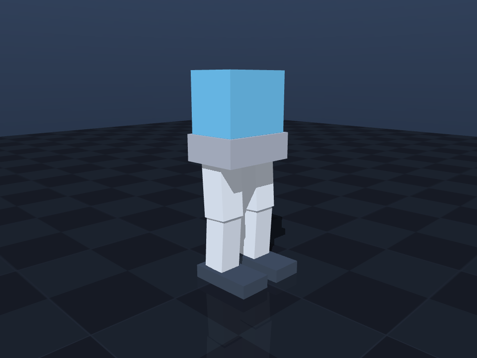

# desktop-robot

EESM 5800「桌面伴侣机器人」课程项目的仿真工程。

目前只做了**机器人本体**：一个腰部 + 双足、9 个驱动自由度的桌面级双足模型，
可以直接用 MuJoCo 打开。整机参数由 Python 生成，模型文件是确定性的生成物。

| | |
| --- | --- |
| 站立高度 | ≈ 0.310 m |
| 总质量 | ≈ 1.510 kg |
| 自由度 | 9 驱动关节（腰偏航 1 + 每腿 4）+ 6 自由度浮动基座 |
| `nq / nv / nu` | 16 / 15 / 9 |
| 几何 | 8 个 box，无外部网格资产 |
| 引擎 | MuJoCo 3.x |

设计细节、坐标约定、简化假设见 **[docs/model_design.md](docs/model_design.md)**。



---

## 环境

固定用这个环境（已建好）：

```
E:\conda_envs\desktop-robot        conda 环境，Python 3.11
```

选 Python 3.11 是因为它是 MuJoCo + Gymnasium + Stable-Baselines3 + PyTorch
这一套强化学习栈目前兼容性最好的版本。

```powershell
conda activate E:\conda_envs\desktop-robot

# 若环境丢失，可以重建：
conda env create -f environment.yml -p E:\conda_envs\desktop-robot
# 或者进入任意 3.11 环境后：
pip install -r requirements.txt
```

三分钟上手：

```powershell
conda activate E:\conda_envs\desktop-robot
cd D:\2026\HKUST\EESM-Robotic\desktop

python -m desktop_robot build     # 生成 models/biped.xml 与 models/scene.xml
python -m desktop_robot verify    # 静态校验（加 --dynamic 会用 MuJoCo 试跑）
python -m desktop_robot view      # 打开 MuJoCo 查看器，按 Esc / 关窗退出
python -m pytest                  # 跑测试
```

没有装 MuJoCo 也能用：`build` / `verify`（静态部分）/ 运动学测试都不依赖它，
`view`、`simulate` 和 `tests/test_mujoco_load.py` 会在缺包时给出提示或自动跳过。

---

## 目录结构

```
desktop/
├─ desktop_robot/            参数化模型生成器（Python 包，扁平布局，无需 pip install）
│  ├─ config.py              ★ 唯一的参数源：尺寸、质量、关节范围、力矩、标称姿态
│  ├─ builder.py             config → MJCF XML（确定性输出）
│  ├─ kinematics.py          正运动学 / 雅可比 / 站立高度反解（只依赖 numpy）
│  ├─ verifier.py            生成物与参数源的交叉校验
│  ├─ sim.py                 MuJoCo 相关入口（延迟导入，缺包时友好提示）
│  └─ __main__.py            CLI：build / verify / view / simulate
│
├─ models/                   生成物，提交入库（没有 Python 也能直接导入 MuJoCo）
│  ├─ biped.xml              机器人本体（8 body / 9 关节 / 9 执行器 / stand 关键帧）
│  └─ scene.xml              include biped.xml + 地面 + 天空盒 + 灯光 + 两个机位 + 求解器设置
│
├─ tests/                    pytest
│  ├─ test_config.py         参数自洽性
│  ├─ test_builder.py        XML 结构与确定性
│  ├─ test_kinematics.py     正运动学、对称性、雅可比
│  ├─ test_verifier.py       校验器（包含"故意改坏后能否抓到"）
│  ├─ test_committed_models.py  生成物必须与参数源同步
│  └─ test_mujoco_load.py    真正加载 + 短时仿真（无 MuJoCo 时 skip）
│
├─ docs/
│  ├─ model_design.md        模型设计说明：坐标、关节表、碰撞、假设
│  ├─ preview_front.png      正视图（报告出图用）
│  └─ preview_iso.png        45° 视图
│
├─ ref/                      课程原始要求（EESM5800_project.md）
├─ build/                    测试临时目录与 pytest 缓存（git 忽略）
├─ environment.yml           conda 环境定义
├─ requirements.txt          pip 依赖
├─ pytest.ini
├─ README.md
└─ LICENSE
```

---

## 模型速查

```
pelvis ──waist_yaw──────────────────────→ torso      （腰部偏航）
   │
   ├──hip_roll──hip_pitch──→ thigh ──knee──→ shank ──ankle──→ foot   （左腿）
   └──hip_roll──hip_pitch──→ thigh ──knee──→ shank ──ankle──→ foot   （右腿）
```

* 俯仰关节轴统一 `(0,-1,0)`：**正角度 = 向前摆**；膝关节负角度 = 屈膝。
* 髋外展轴左 `(1,0,0)`、右 `(-1,0,0)`：**两腿正角度都是外展**，控制器不用翻号。
* 足底水平判据：`髋俯仰 + 膝 + 踝 = 0`。
* 标称站姿关键帧 `stand`：髋 `+0.06`、膝 `-0.12`、踝 `+0.06`，骨盆高 `0.1997 m`。

---

## 改参数的工作流

```powershell
# 1) 改 desktop_robot/config.py 的 DEFAULT_SPEC
# 2) 重新生成模型
python -m desktop_robot build
# 3) 校验（建议带 --dynamic）
python -m desktop_robot verify --dynamic
# 4) 测试：test_committed_models 会确认生成物已同步
python -m pytest
```

`models/*.xml` 虽然是生成物，但**提交进 git**——这样没有 Python 环境的人也能
双击打开模型。`tests/test_committed_models.py` 保证它不会悄悄过期。

---

## git 约定

* `models/*.xml` 提交（生成物，但保证可用性）。
* `build/`、`.pytest_cache/`、`__pycache__/`、`.venv/` 忽略。
* 无二进制模型资产，仓库体积很小，不需要 Git LFS。
* 建议的提交粒度：参数改动 + 重新生成的 XML + 测试改动放在同一个 commit。
  提交前先跑 `python -m pytest`。

---

## 后续可以接的东西

这个工程刻意只做到"模型 + 工具链"，下面这些留作下一步：

* 逆运动学与步态生成（`kinematics.py` 已有雅可比，可以直接接）
* Gymnasium 环境封装（`gymnasium[mujoco]` 已装好，模型可直接注册为环境）
* 强化学习训练（按需 `pip install stable-baselines3`，torch 体积较大所以没预装）
* 头部/手臂等表达性机构（加进 `config.py` 后重新生成即可）

---

## 附：仓库自带的 skill-creator

本项目还自带一个用于生成 skill 的工具：[skill-creator](.agents/skills/skill-creator/SKILL.md)。

- 调用：在对话里说「帮我生成一个 skill」，或输入 `/skill-creator`。
- 存放：新 skill 写到 `.agents/skills/<name>/SKILL.md`（DSH 只扫描根目录下一层）。
- 校验：`node .agents/skills/skill-creator/scripts/validate-skill.mjs <skill-directory>`。
