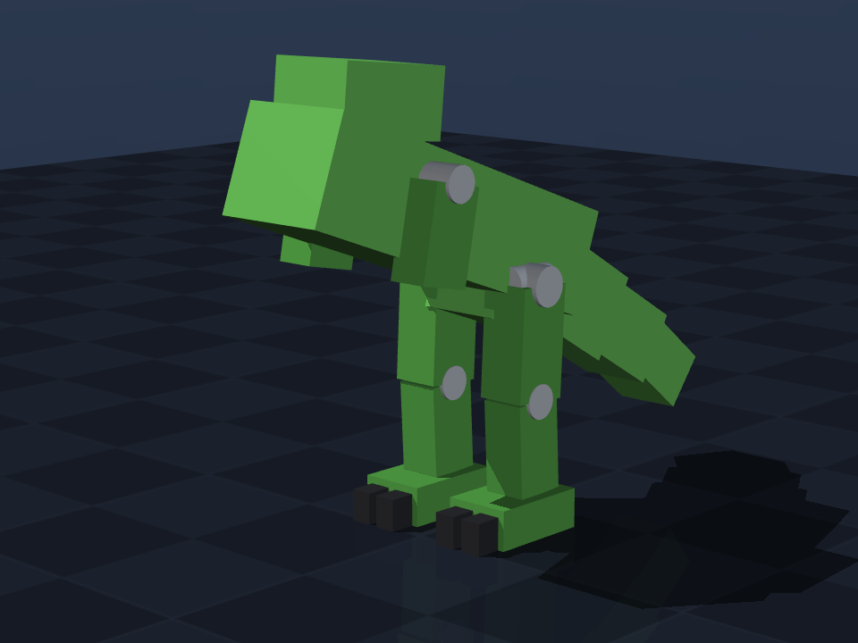
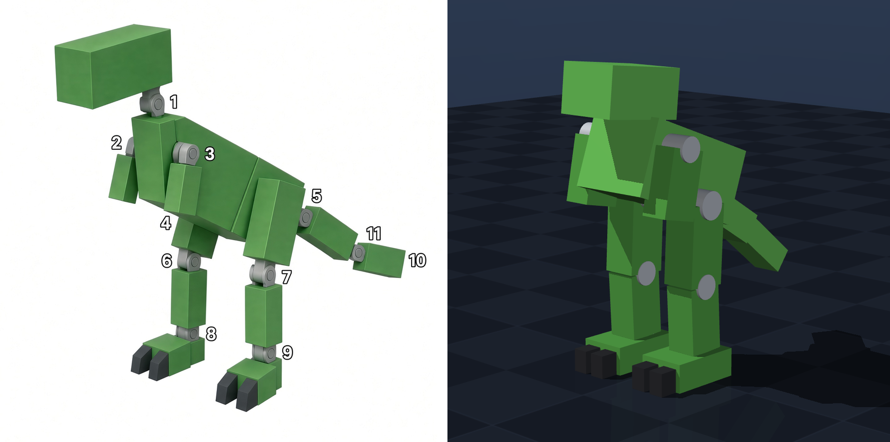

# 桌面恐龙机器人（dino）模型设计说明

本文档描述 `models/dino.xml` 里那台**霸王龙式双足桌面机器人**的几何、关节、约定与简化假设。
**所有数值都来自 [`desktop_robot/dino.py`](../desktop_robot/dino.py) 的 `DEFAULT_DINO_SPEC`**；
本文档只做解释，改参数请改 `dino.py` 再重新生成，不要手改 XML。





---

## 1. 一句话规格

| 项目 | 数值 |
| --- | --- |
| 站立总高（脚底→头顶） | ≈ 0.307 m |
| 总质量（密度 400 kg/m³ 估算） | ≈ 2.00 kg |
| 驱动关节 | 18 个（俯仰 pitch 11 / 偏航 yaw 5 / 内外翻 roll 2）+ 6 自由度浮动基座 |
| `nq / nv / nu` | 25 / 24 / 18 |
| body 数量 | 14（尾巴 4 节；每条腿的 5 个关节都挂在同一个 thigh body 上） |
| 几何 | 18 个 box（含 4 个前趾）+ 18 个视觉轴承圆柱，无外部网格 |
| 传感器 | 1 个头部相机 `cam_head`（挂在 `head` body 上） |
| 站立基座高度 | 0.1841 m（由正运动学反解，保证足底刚好贴地） |

## 2. 关节编号（按 qpos 顺序）

下表 ①–⑱ 就是 qpos 里关节的顺序（= body 深度优先遍历 + body 内关节定义顺序）。
其中 ⑦ / ⑫（每条腿的**脚尖偏航** `hip_yaw`）是本版相对参考图**新增**的自由度，
参考图上没有标号；其余关节仍与参考图一一对应，所以膝盖及之后的编号比原图后移了 2。

| 编号 | 关节 | 编号 | 关节 |
| --- | --- | --- | --- |
| ① | `neck_pitch`（颈，上下） | ⑩ | `hip_pitch_R`（右髋，主髋） |
| ② | `neck_yaw`（头，左右，轴 z） | ⑪ | `hip_roll_R`（右腿，内外翻，轴 x） |
| ③ | `shoulder_pitch_L`（左肩） | ⑫ | `hip_yaw_R`（右腿，脚尖外旋，轴 z，新增） |
| ④ | `shoulder_pitch_R`（右肩） | ⑬ | `knee_R`（右膝） |
| ⑤ | `hip_pitch_L`（左髋，主髋） | ⑭ | `ankle_R`（右踝） |
| ⑥ | `hip_roll_L`（左腿，内外翻，轴 x） | ⑮ | `tail1_yaw`（尾第 1 节，侧向，轴 z） |
| ⑦ | `hip_yaw_L`（左腿，脚尖外旋，轴 z，新增） | ⑯ | `tail2_pitch`（尾第 2 节，上下） |
| ⑧ | `knee_L`（左膝） | ⑰ | `tail3_yaw`（尾第 3 节，侧向，轴 z） |
| ⑨ | `ankle_L`（左踝） | ⑱ | `tail4_pitch`（尾第 4 节，上下） |

## 3. 拓扑

```text
torso（浮动基座，freejoint: root）
├─ head          [neck_pitch]          ①（上下）→ [neck_yaw] ②（左右）
│                └─ camera cam_head（头部前视相机，随颈 / 头一起转）
├─ arm_L         [shoulder_pitch_L]    ③
├─ arm_R         [shoulder_pitch_R]    ④
├─ thigh_L       [hip_pitch_L]         ⑤（主髋）→ [hip_roll_L] ⑥（内外翻）
│  │                                    → [hip_yaw_L] ⑦（脚尖外旋）
│  └─ shank_L    [knee_L]              ⑧
│     └─ foot_L  [ankle_L]             ⑨
├─ thigh_R       [hip_pitch_R]         ⑩ → [hip_roll_R] ⑪ → [hip_yaw_R] ⑫
│  └─ shank_R    [knee_R]              ⑬
│     └─ foot_R  [ankle_R]             ⑭
└─ tail_1        [tail1_yaw]           ⑮（侧向）
   └─ tail_2     [tail2_pitch]         ⑯（上下）
      └─ tail_3  [tail3_yaw]           ⑰（侧向）
         └─ tail_4 [tail4_pitch]       ⑱（上下）
```

图里没有腰关节，所以 **torso 直接做浮动基座**；标称站姿靠 freejoint 的四元数让躯干抬头。
每条腿的「髋 pitch → 内外翻 → 脚尖 yaw」和头部的「pitch → yaw」都写在**同一个 body** 里，
按定义顺序复合，所以内外翻 / 脚尖朝向 / 转头都发生在主关节之后（和设计要求一致）。
每条腿共 5 个关节，`thigh` body 上挂 3 个（pitch / roll / yaw），body 数量仍然是 14。

## 4. 连杆尺寸（全尺寸，m）

| 连杆 | 形状 | 全尺寸 (x, y, z) | 相对父关节偏移 | 长度来源 |
| --- | --- | --- | --- | --- |
| torso | box | 0.300 × 0.095 × 0.085 | —（基座原点＝几何中心） | — |
| head | box | 0.100 × 0.072 × 0.055 | 颈在 torso (0.055, 0, 0.050)；头中心再 (+0.032, 0, +0.022) | 显式偏移 |
| `cam_head` | 相机（无质量） | — | 相对 head body 原点 (0.086, 0, 0.026)，贴在脸部前方 | `head_camera_pos` |
| arm_L/R | box | 0.045 × 0.032 × 0.075 | 肩在 torso (0.048, ±0.058, 0.018)；中心 (0, 0, −臂长/2) | `arm_size[2]` |
| thigh_L/R | box | 0.048 × 0.040 × 0.050 | 髋在 torso (−0.085, ±0.045, −0.030)；中心 (0, 0, −大腿长/2) | `thigh_size[2]` |
| shank_L/R | box | 0.044 × 0.036 × 0.045 | 膝在 thigh (0, 0, −大腿长)；中心 (0, 0, −小腿长/2) | `shank_size[2]` |
| foot_L/R | box | 0.085 × 0.055 × 0.032 | 踝在 shank (0, 0, −小腿长)；中心 (0.012, 0, −0.016) | 显式偏移 |
| toe_L/R ×2 | box | 0.028 × 0.018 × 0.026 | 贴住足前端与足底，`±toe_y` 左右各一 | `toe_size`、`toe_y` |
| tail_1 | box | 0.080 × 0.070 × 0.086 | 尾根在 torso (−0.068, 0, −0.020)；中心 (−尾 1 长/2, 0, 0) | `tail1_size[0]` |
| tail_2 | box | 0.075 × 0.065 × 0.074 | 尾 2 关节在 tail_1 (−尾 1 长, 0, 0)；中心 (−尾 2 长/2, 0, 0) | `tail2_size[0]` |
| tail_3 | box | 0.070 × 0.061 × 0.062 | 尾 3 关节在 tail_2 (−尾 2 长, 0, 0)；中心 (−尾 3 长/2, 0, 0) | `tail3_size[0]` |
| tail_4 | box | 0.060 × 0.056 × 0.050 | 尾 4 关节在 tail_3 (−尾 3 长, 0, 0)；中心 (−尾 4 长/2, 0, 0) | `tail4_size[0]` |

每个铰链处还有一个灰色圆柱（`cap_*`）：只做视觉、**零质量、不参与碰撞**，用来还原参考图里的轴承外壳。
轴承圆柱的朝向跟着关节轴走（俯仰沿 y、偏航沿 z、内外翻沿 x），18 个驱动关节各有一个。

## 5. 关节

| 关节 | 父 → 子 | 轴 | 范围 (rad) | kp / kv | 力矩上限 |
| --- | --- | --- | --- | --- | --- |
| `neck_pitch` | torso → head | (0, −1, 0) | ±0.70 | 25 / 1.0 | ±2.5 N·m |
| `neck_yaw` | head（pitch 之后） | (0, 0, 1) | ±0.60 | 25 / 1.0 | ±2.5 N·m |
| `shoulder_pitch_L/R` | torso → arm | (0, −1, 0) | ±1.20 | 25 / 1.0 | ±2.5 N·m |
| `hip_pitch_L/R` | torso → thigh | (0, −1, 0) | ±1.20 | 25 / 1.0 | ±2.5 N·m |
| `hip_roll_L/R` | thigh（pitch 之后） | (1, 0, 0) / (−1, 0, 0) | ±0.35 | 25 / 1.0 | ±2.5 N·m |
| `hip_yaw_L/R` | thigh（roll 之后） | (0, 0, 1) / (0, 0, −1) | ±0.60 | 25 / 1.0 | ±2.5 N·m |
| `knee_L/R` | thigh → shank | (0, −1, 0) | [−1.60, 0.05] | 25 / 1.0 | ±2.5 N·m |
| `ankle_L/R` | shank → foot | (0, −1, 0) | [−0.60, 0.80] | 25 / 1.0 | ±2.0 N·m |
| `tail1_yaw` | torso → tail_1 | (0, 0, 1) | ±0.50 | 25 / 1.0 | ±2.5 N·m |
| `tail2_pitch` | tail_1 → tail_2 | (0, −1, 0) | [−0.80, 0.50] | 25 / 1.0 | ±2.5 N·m |
| `tail3_yaw` | tail_2 → tail_3 | (0, 0, 1) | ±0.50 | 25 / 1.0 | ±2.5 N·m |
| `tail4_pitch` | tail_3 → tail_4 | (0, −1, 0) | [−0.80, 0.50] | 25 / 1.0 | ±2.5 N·m |

符号约定：

* 俯仰：正角 = 子连杆向前摆；对朝后的尾巴，正角 = 尾尖下压。
* 偏航：正角 = 从上往下看逆时针（头部向左、尾尖向右）。
* 内外翻：左右腿的轴互为镜像（`mirror_x`），**两腿正角都表示外翻**，控制器不用翻号。
* 脚尖偏航：左右腿的轴互为镜像（`mirror_z`：左 `(0,0,1)`、右 `(0,0,−1)`），
  **两腿正角都表示脚尖外旋**（左脚尖转向 +y、右脚尖转向 −y），同样不用翻号。

> 注意：XML 里写的 `range` 已经减去站姿角（零位=站姿），上表是**物理角度**。

## 6. 标称站姿

| 参数 | 值 | 说明 |
| --- | --- | --- |
| `base_pitch` | 20° | 躯干抬头（freejoint 四元数，绕 (0, −1, 0)） |
| `stand_neck` | −0.25 | 头相对躯干低头，最终头约抬头 5.7° |
| `stand_neck_yaw` | 0 | 头正对前方 |
| `stand_shoulder` | −0.15 | 手臂自然下垂、略前摆 |
| `stand_hip` | −0.30 | 大腿基本竖直 |
| `stand_hip_roll` | 0 | 两腿不内/外翻 |
| `stand_hip_yaw` | 0 | 脚尖正对前方 |
| `stand_knee` | −0.10 | 轻微屈膝 |
| `stand_ankle` | **自动** | `−(base_pitch + stand_hip + stand_knee)`，保证足底水平 |
| `stand_tail1_yaw` / `stand_tail3_yaw` | 0 / 0 | 尾巴在矢状面内 |
| `stand_tail2_pitch` / `stand_tail4_pitch` | −0.10 / −0.05 | 尾巴略微上扬、**离地约 4.3 cm**（不再作为支撑点） |
| 基座高度 | 0.1841 m | 由 `solve_base_z()` 用足 + 前趾 24 个顶点反解，最低点贴地 |

尾巴第 1 节现在是 yaw 关节，所以站姿下它只跟着躯干的 20° 抬头，不再单独下垂。
v2.2 起尾巴 pitch 改成 −0.10 / −0.05（原来是 0.18 / 0.14）：尾巴最低点从触地（约 4.7 N）
抬到离地约 4.3 cm，**站立只靠双脚**；WBC 训练里 stand/lift/turn 阶段尾巴触地会直接终止。

## 7. 头部相机

`head` body 里除了 `head_geom` 还有一个前视相机 `cam_head`（MJCF 的 `<camera>`），
参数同样写在 [`desktop_robot/dino.py`](../desktop_robot/dino.py) 的 `DinoSpec` 字段里：

| 字段 | 值 | 含义 |
| --- | --- | --- |
| `head_camera_pos` | (0.086, 0, 0.026) | 相对 `head` body 原点的位置，贴在脸部前方 |
| `head_camera_xyaxes` | `0 -1 0 0.2079 0 0.9781` | 相机 x 轴（画面右方）与 y 轴（画面上方）；相机沿自身的 −z 方向看，因此相对头部**下俯 12°** |
| `head_camera_fovy` | 75.0 | 竖直视场角（度） |

* 因为写在 `head` body 里，`cam_head` 会跟着 `neck_pitch` / `neck_yaw` 一起转。
  相机相对头部下俯 12°，而站姿头部净俯仰约 +5.7°，所以世界视线约**下俯 6.3°**：
  第一视角里能同时看到前方地面和少量天空，不会只剩天空。
* 相机是**无质量、无碰撞**的传感器元素，不参与动力学；`verify-dino` 会校验它确实挂在
  `head` body 下，且 `pos` / `xyaxes` / `fovy` 与参数源一致。
* 拿它做第一人称观测或出图：

```python
import mujoco

model = mujoco.MjModel.from_xml_path("models/dino_scene.xml")
data = mujoco.MjData(model)
mujoco.mj_forward(model, data)
cam_id = mujoco.mj_name2id(model, mujoco.mjtObj.mjOBJ_CAMERA, "cam_head")
# 位姿在 data.cam_xpos[cam_id] / data.cam_xmat[cam_id]；
# 也可以把它交给 mujoco.Renderer 的 update_scene(camera=...) 做第一人称渲染。
```

## 8. 改尺寸 / 改姿态的正确姿势

**改某个连杆的长度**：直接改 `DinoSpec` 的 `*_size`，关节锚点在生成时按长度重算。

```python
from dataclasses import replace
from desktop_robot.dino import DEFAULT_DINO_SPEC, write_dino_models

spec = replace(
    DEFAULT_DINO_SPEC,
    thigh_size=(0.048, 0.040, 0.060),   # 大腿长 50 → 60 mm
    shank_size=(0.044, 0.036, 0.055),   # 小腿长 45 → 55 mm
    tail2_size=(0.090, 0.065, 0.074),   # 尾 2 长 75 → 90 mm
    tail3_size=(0.085, 0.061, 0.062),   # 尾 3 长 70 → 85 mm
)
write_dino_models(spec)                 # 重新生成 models/dino.xml + dino_scene.xml
```

生成时自动联动的东西：

* 膝关节位置 = −大腿长，踝关节位置 = −小腿长；
* 逐级尾巴 body 的位置 = 上一节长度（`tail_2` 在 −tail1_len、`tail_3` 在 −tail2_len …）；
* 臂/腿/尾的几何中心 = 各自长度的一半；
* 站立基座高度重新反解，保证脚底仍然贴地；
* 前趾始终贴住足前端与足底（`toe_center` 由 `foot_size` / `toe_size` 派生）。

想改「关节挂在躯干上的位置」就改 `neck_pos` / `shoulder_pos` / `hip_pos` / `tail1_pos`；
想改姿态就改 `base_pitch` / `stand_*`（踝角会自动反解；`stand_hip_roll` / `stand_hip_yaw`、
`stand_neck_yaw`、两个尾 yaw 的站姿角默认都是 0，真的给它们非零站姿时，零位=站姿的写法
会把站姿角烘进 body 的 `quat`，但 XML 的 range 只做了逐关节平移，多关节同 body 的非零站姿
要额外检查）。

## 9. 生成 / 校验 / 查看

```powershell
conda activate E:\conda_envs\desktop-robot
cd D:\2026\HKUST\EESM-Robotic\desktop

python -m desktop_robot build-dino          # 生成 models/dino.xml + dino_scene.xml
python -m desktop_robot verify-dino --dynamic   # 静态 + MuJoCo 加载/站姿校验
python -m desktop_robot view --model dino_scene # 打开查看器
python -m desktop_robot simulate --model dino_scene --steps 1000
python -m pytest tests/test_dino.py tests/test_dino_mujoco.py
```

预览图由 `models/dino_scene.xml` 的 `iso` / `ref` 机位（后者是接近参考图的 3/4 视角、窄视场）用
`mujoco.Renderer` 出图，可以直接复用出报告图。

## 10. 简化假设

1. **有髋 yaw（脚尖偏航），没有腰 yaw**：每条腿是「主髋 pitch + 内外翻 + 脚尖 yaw + 膝 + 踝」
   5 自由度；侧向自由度在头（yaw）、腿（roll + 脚尖 yaw）、尾巴（两处 yaw）。
   两腿脚尖 / 髋同时转向时，上身相对脚掌就能偏转，配合步态可以做原地转身；
   但躯干与腿之间没有独立的偏航关节，转身时两只脚必须一起参与。
2. 关节轴写在所在 body 的局部坐标系里（零位=站姿），所以站在站姿时轴的世界方向会带一点倾斜：
   头 yaw 约 5.7°、髋内外翻约 2.8°、脚尖 yaw 约 2.8°、尾根 yaw 约 20°、尾 3 yaw 约 30°
   （躯干抬头 + 尾 2 下垂）。要严格世界竖直/水平的轴，需要在 `DinoSpec` 里把轴向量改成补偿值。
3. 图里没有腰关节，torso 直接做浮动基座；头/躯干/尾巴的姿态都靠关节实现。
4. 手臂只有 1 段，没有肘/手；尾巴 4 节；足是方块 + 2 个深灰色前趾。
5. 关节轴承只是视觉圆柱（零质量、无碰撞），不模拟轴承间隙、摩擦和回差。
6. 密度取 400 kg/m³（含舵机、电池、结构件的等效平均密度），总质量 2.00 kg 是估计值；
   MuJoCo 实测 `body_subtreemass` 与 `total_mass()` 一致。
7. 连杆之间不碰撞（只有足和地板接触），避免仿真里相邻零件互相弹开。
8. 尺寸来自参考图的像素比例，总高按桌面级取 0.31 m 量级；有实测尺寸时应直接替换 `*_size`。
