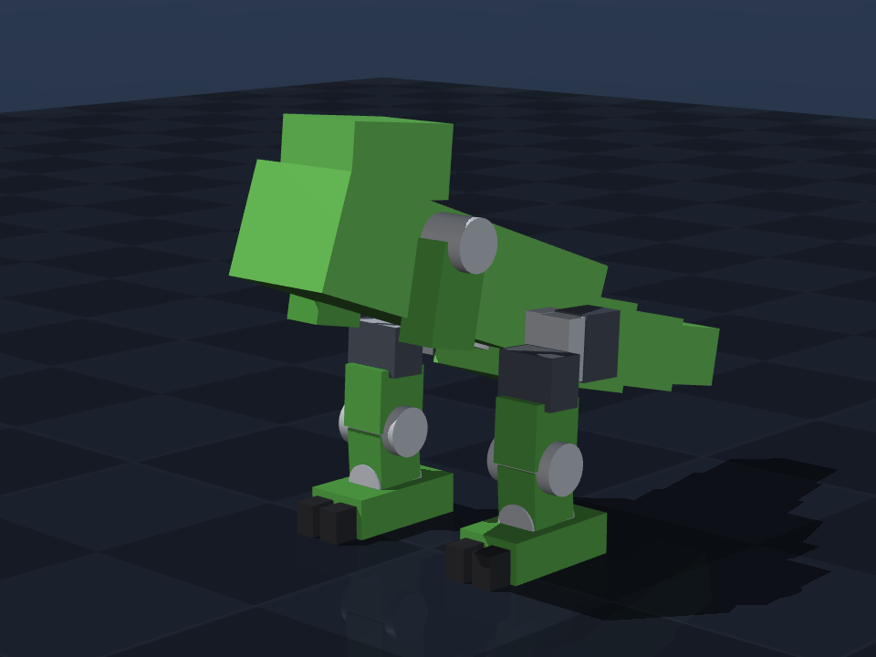
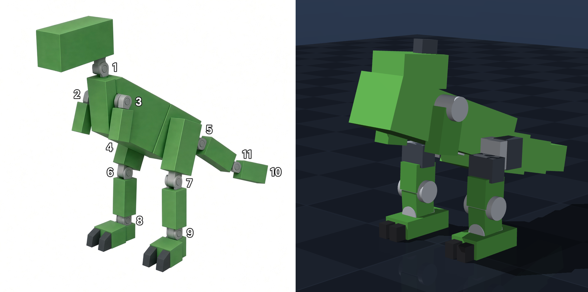

# 桌面恐龙机器人（dino）模型设计说明

本文档描述 `models/dino.xml` 里那台**霸王龙式双足桌面机器人**的几何、关节、约定与简化假设。
**所有数值都来自 [`desktop_robot/dino.py`](../desktop_robot/dino.py) 的 `DEFAULT_DINO_SPEC`**；
本文档只做解释，改参数请改 `dino.py` 再重新生成，不要手改 XML。





---

## 1. 一句话规格

| 项目 | 数值 |
| --- | --- |
| 外形包络（长 × 宽 × 高） | **0.344 × 0.150 × 0.238 m**（结构件；算上头顶 MG90 包络最高到 0.249 m） |
| 站立总高（脚底→头顶） | ≈ 0.238 m |
| 总质量（体积 × PLA 1240 kg/m³） | ≈ 2.23 kg（只算塑料件，不含舵机 / 电池） |
| 驱动关节 | 18 个（俯仰 pitch 9 / 偏航 yaw 5 / 内外翻 roll 4）+ 6 自由度浮动基座 |
| `nq / nv / nu` | 25 / 24 / 18 |
| body 数量 | 21（颈 pitch 段 1 + 头 1；尾巴 4 节；每条腿 6 个：三段髋安装板 + 大腿 + 小腿 + 足） |
| 几何 | 25 个结构 box（含颈段 20 mm 立柱）+ **8 个电机包络**（髋 3×2、颈 2）+ 10 个视觉轴承圆柱，无外部网格 |
| 传感器 | 1 个头部相机 `cam_head`（挂在 `head` body 上） |
| 站立基座高度 | 0.1517 m（由正运动学反解，保证足底刚好贴地） |
| 髋部电机 | 3 × ROBOTIS `XC330-T181-T`（20 × 34 × 26 mm，D 沿输出轴；电机体缩进连杆、彼此不相交） |
| 头部电机 | 2 × 标准 MG90（22.8 × 12.2 × 28.5 mm，轴过 22.8 × 12.2 端面中心，两台的包络都以颈关节为中心对称摆） |

## 2. 关节编号（按 qpos 顺序）

下表 ①–⑱ 就是 qpos 里关节的顺序（= body 深度优先遍历 + body 内关节定义顺序）。
其中 ⑦ / ⑫（每条腿的**脚尖偏航** `hip_yaw`）是本版相对参考图**新增**的自由度，
参考图上没有标号；其余关节仍与参考图一一对应，所以膝盖及之后的编号比原图后移了 2。

| 编号 | 关节 | 编号 | 关节 |
| --- | --- | --- | --- |
| ① | `neck_pitch`（颈，上下） | ⑩ | `hip_pitch_R`（右髋，主髋） |
| ② | `neck_yaw`（头，左右，轴 z） | ⑪ | `hip_roll_R`（右腿，内外翻，轴 x） |
| ③ | `shoulder_pitch_L`（左肩） | ⑫ | `hip_yaw_R`（右腿，脚尖外旋，轴 z） |
| ④ | `shoulder_pitch_R`（右肩） | ⑬ | `knee_R`（右膝） |
| ⑤ | `hip_pitch_L`（左髋，主髋） | ⑭ | `ankle_R`（右踝，内外翻，轴 x） |
| ⑥ | `hip_roll_L`（左腿，内外翻，轴 x） | ⑮ | `tail1_yaw`（尾第 1 节，侧向，轴 z） |
| ⑦ | `hip_yaw_L`（左腿，脚尖外旋，轴 z） | ⑯ | `tail2_pitch`（尾第 2 节，上下） |
| ⑧ | `knee_L`（左膝） | ⑰ | `tail3_yaw`（尾第 3 节，侧向，轴 z） |
| ⑨ | `ankle_L`（左踝，内外翻，轴 x） | ⑱ | `tail4_pitch`（尾第 4 节，上下） |

## 3. 拓扑

```text
torso（浮动基座，freejoint: root）
├─ neck          [neck_pitch]          ①（上下）；body 里还有一根 20 mm 立柱 neck_geom
│  └─ head       [neck_yaw]            ②（左右，轴 z）
│                 └─ camera cam_head（头部前视相机，随头一起转）
├─ arm_L         [shoulder_pitch_L]    ③
├─ arm_R         [shoulder_pitch_R]    ④
├─ hip_pitch_L   [hip_pitch_L]         ⑤（主髋块）
│  └─ hip_roll_L [hip_roll_L]          ⑥（内外翻块）
│     └─ hip_yaw_L [hip_yaw_L]         ⑦（脚尖偏航块）
│        └─ thigh_L （无关节大腿块）
│           └─ shank_L    [knee_L]     ⑧
│              └─ foot_L  [ankle_L]    ⑨（内外翻，轴 x）
├─ hip_pitch_R   [hip_pitch_R]         ⑩ → [hip_roll_R] ⑪ → [hip_yaw_R] ⑫ → thigh_R
│  └─ shank_R    [knee_R]              ⑬
│     └─ foot_R  [ankle_R]             ⑭（内外翻，轴 x）
└─ tail_1        [tail1_yaw]           ⑮（侧向）
   └─ tail_2     [tail2_pitch]         ⑯（上下）
      └─ tail_3  [tail3_yaw]           ⑰（侧向）
         └─ tail_4 [tail4_pitch]       ⑱（上下）
```

图里没有腰关节，所以 **torso 直接做浮动基座**；标称站姿靠 freejoint 的四元数让躯干抬头。
髋部的三个关节**各自挂在一块长方体安装板上、串成三段**：`hip_pitch` → `hip_roll` →
`hip_yaw` → `thigh`。每块板 13 mm 厚，端面就是 **ROBOTIS XC330-T181-T**（20 × 34 × 26 mm）
的 20 × 34 安装面；**电机体（轴向 26 mm）缩进上一级连杆**——pitch 缩进躯干、roll 缩进
pitch 板的后面、yaw 缩进 roll 板的下方。每段 body 的原点相对上一关节沿其轴偏出
`hip_roll_offset` / `hip_yaw_offset` / `thigh_offset`（默认 24 mm），偏距按左右镜像
（`y` 分量取反），两腿对称。`thigh` body 上不再有关节，只放大腿方块。

**关节（电机）之间不能互相嵌入**：三台髋电机 + 两台颈电机都按各自型号的包络显式画出来
（深灰 `motor_*`），并按「pitch 往内、roll 往后、yaw 往下」错开，包络两两不相交。
髋部三台是 XC330-T181-T（20 × 34 × 26 + 2 mm 间隙）；**颈部两台都是 MG90**
（22.8 × 12.2 × 28.5 mm，轴沿 28.5、过 22.8 × 12.2 端面中心），并且都以颈关节为中心
左右对称：pitch 的机体横着跨在颈上。颈部的两段之间有一根 **20 mm 的真实立柱**
（`neck` body 上的 `neck_geom`，`neck_joint_offset` = 20 mm）：`neck` body 带 pitch 关节、
立柱从 0 长到 20 mm，`head` body 顶在立柱上、带 yaw 关节，所以两台电机的关节沿轴向
正好隔开 20 mm，实测包络间隙约 10 mm。这条立柱让运动学链里出现一个真实连杆，
而不是把 20 mm 藏在关节锚点里。
这条约束由 `tests/test_dino_mujoco.py::test_joint_volumes_do_not_intersect` 用分离轴
定理（SAT）逐对验证，包括 3 块髋安装板彼此之间也不相交。

## 4. 连杆尺寸（全尺寸，m）

| 连杆 | 形状 | 全尺寸 (x, y, z) | 相对父关节偏移 | 长度来源 |
| --- | --- | --- | --- | --- |
| torso | box | 0.210 × 0.0665 × 0.0595 | —（基座原点＝几何中心） | — |
| neck | box（立柱） | 0.020 × 0.014 × 0.020 | pitch 关节在 torso (0.0385, 0, 0.035)；立柱从关节沿 +z 长 20 mm（中心 z = +0.010） | `neck_size`、`neck_joint_offset` |
| head | box | 0.070 × 0.0504 × 0.0385 | head body 在 neck body 上方 20 mm；头中心再 (+0.0224, 0, −0.0046)（相对 head body） | 显式偏移 |
| `cam_head` | 相机（无质量） | — | 相对 head body 原点 (0.0602, 0, −0.0018)，贴在脸部前方 | `head_camera_pos` |
| arm_L/R | box | 0.0315 × 0.0224 × 0.0525 | 肩在 torso (0.0336, ±0.0406, 0.0126)；中心 (0, 0, −臂长/2) | `arm_size[2]` |
| `hip_pitch_L/R` | box（安装板 1） | 0.020 × 0.013 × 0.034 | 主髋在 torso (−0.0595, ±0.0315, −0.021)；x=W、y=板厚(轴向)、z=H，中心 (0, ±0.0065, 0) | `hip_pitch_size`、`hip_roll_offset` |
| `hip_roll_L/R` | box（安装板 2） | 0.013 × 0.020 × 0.034 | 在内外翻关节上；x=板厚(轴向)、y=W、z=H，中心 (0.0065, 0, 0) | `hip_roll_size`、`hip_yaw_offset` |
| `hip_yaw_L/R` | box（安装板 3） | 0.020 × 0.034 × 0.013 | 在脚尖偏航关节上；x=W、y=H、z=板厚(轴向)，中心 (0, 0, −0.0065) | `hip_yaw_size`、`thigh_offset` |
| thigh_L/R | box | 0.0336 × 0.028 × 0.035 | 大腿 body 在 yaw 关节下方 24 mm；中心 (0, 0, −大腿长/2) | `thigh_size[2]` |
| shank_L/R | box | 0.0308 × 0.0252 × 0.0315 | 膝在 thigh (0, 0, −大腿长)；中心 (0, 0, −小腿长/2) | `shank_size[2]` |
| foot_L/R | box | 0.0735 × 0.0385 × 0.0224 | 踝在 shank (0, 0, −小腿长)；中心 (0.0014, 0, −0.0112)；脚跟比原设计长 14 mm（前趾位置不变） | 显式偏移 |
| toe_L/R ×2 | box | 0.0196 × 0.0126 × 0.0182 | 贴住足前端与足底，`±toe_y` 左右各一 | `toe_size`、`toe_y` |
| tail_1 | box | 0.056 × 0.049 × 0.0602 | 尾根在 torso (−0.0476, 0, −0.014)；中心 (−尾 1 长/2, 0, 0) | `tail1_size[0]` |
| tail_2 | box | 0.0525 × 0.0455 × 0.0518 | 尾 2 关节在 tail_1 (−尾 1 长, 0, 0)；中心 (−尾 2 长/2, 0, 0) | `tail2_size[0]` |
| tail_3 | box | 0.049 × 0.0427 × 0.0434 | 尾 3 关节在 tail_2 (−尾 2 长, 0, 0)；中心 (−尾 3 长/2, 0, 0) | `tail3_size[0]` |
| tail_4 | box | 0.042 × 0.0392 × 0.035 | 尾 4 关节在 tail_3 (−尾 3 长, 0, 0)；中心 (−尾 4 长/2, 0, 0) | `tail4_size[0]` |

每个非髋、非颈铰链处还有一个灰色圆柱（`cap_*`）：只做视觉、**零质量、不参与碰撞**，
用来还原参考图里的轴承外壳。朝向跟着关节轴走（俯仰沿 y、偏航沿 z、内外翻沿 x），
10 个关节各有一个；髋部三个关节和颈部两个关节不画圆柱，改画下面的电机包络。

8 个电机包络（`motor_*`，深灰、零密度、无碰撞，只做视觉）的位置和尺寸由
`DinoSpec.joint_motors()` 统一给出：髋部三台是 XC330（20 × 34 × 26），
颈部两台是 MG90（22.8 × 12.2 × 28.5），都加两侧 1 mm 间隙，机体沿各自的输出轴伸出：

| 电机 | 型号 | 所在 body | 摆放（相对本关节） | 包络 (x, y, z) |
| --- | --- | --- | --- | --- |
| `motor_hip_pitch_L/R` | XC330 | `hip_pitch_*` | 沿 −y 往身体内侧伸 26 mm | 0.022 × 0.028 × 0.036 |
| `motor_hip_roll_L/R` | XC330 | `hip_pitch_*` | 沿 −x 往后伸 26 mm（贴在 roll 关节后方） | 0.028 × 0.022 × 0.036 |
| `motor_hip_yaw_L/R` | XC330 | `hip_roll_*` | 沿 −z 往下伸 26 mm | 0.022 × 0.036 × 0.028 |
| `motor_neck_pitch` | MG90 | `torso` | 轴沿 y、横跨在颈关节上（y 方向居中） | 0.0248 × 0.0305 × 0.0142 |
| `motor_neck_yaw` | MG90 | `head` | 轴沿 z；head body 已在 yaw 关节处，机体从这个原点往上伸（底面与关节齐平） | 0.0248 × 0.0142 × 0.0305 |

## 5. 关节

| 关节 | 父 → 子 | 轴 | 范围 (rad) | kp / kv | 力矩上限 |
| --- | --- | --- | --- | --- | --- |
| `neck_pitch` | torso → head | (0, −1, 0) | ±0.70 | 25 / 1.0 | ±2.5 N·m |
| `neck_yaw` | neck（20 mm 立柱之后） | (0, 0, 1) | ±0.60 | 25 / 1.0 | ±2.5 N·m |
| `shoulder_pitch_L/R` | torso → arm | (0, −1, 0) | ±1.20 | 25 / 1.0 | ±2.5 N·m |
| `hip_pitch_L/R` | torso → hip_pitch 块 | (0, −1, 0) | ±1.20 | 25 / 1.0 | ±2.5 N·m |
| `hip_roll_L/R` | hip_pitch 块 → hip_roll 块 | (1, 0, 0) / (−1, 0, 0) | ±0.35 | 25 / 1.0 | ±2.5 N·m |
| `hip_yaw_L/R` | hip_roll 块 → hip_yaw 块 | (0, 0, 1) / (0, 0, −1) | ±0.60 | 25 / 1.0 | ±2.5 N·m |
| `knee_L/R` | thigh → shank | (0, −1, 0) | [−1.60, 0.05] | 25 / 1.0 | ±2.5 N·m |
| `ankle_L/R` | shank → foot | (1, 0, 0) / (−1, 0, 0) | ±0.35 | 25 / 1.0 | ±2.0 N·m |
| `tail1_yaw` | torso → tail_1 | (0, 0, 1) | ±0.50 | 25 / 1.0 | ±2.5 N·m |
| `tail2_pitch` | tail_1 → tail_2 | (0, −1, 0) | [−0.80, 0.50] | 25 / 1.0 | ±2.5 N·m |
| `tail3_yaw` | tail_2 → tail_3 | (0, 0, 1) | ±0.50 | 25 / 1.0 | ±2.5 N·m |
| `tail4_pitch` | tail_3 → tail_4 | (0, −1, 0) | [−0.80, 0.50] | 25 / 1.0 | ±2.5 N·m |

符号约定：

* 俯仰：正角 = 子连杆向前摆；对朝后的尾巴，正角 = 尾尖下压。
* 偏航：正角 = 从上往下看逆时针（头部向左、尾尖向右）。
* 内外翻：左右腿的轴互为镜像（`mirror_x`），**两腿正角都表示外翻**，控制器不用翻号；
  髋 `hip_roll` 与踝 `ankle` 都是这一类。
* 脚尖偏航：左右腿的轴互为镜像（`mirror_z`：左 `(0,0,1)`、右 `(0,0,−1)`），
  **两腿正角都表示脚尖外旋**（左脚尖转向 +y、右脚尖转向 −y），同样不用翻号。

> 注意：XML 里写的 `range` 已经减去站姿角（零位=站姿），上表是**物理角度**。
> 踝现在是 roll 关节、站姿角为 0，所以它的 XML range 与物理范围相同（±0.35）。

**踝没有俯仰自由度**：脚掌的俯仰由 `foot_mount_pitch`（固定安装角，+2.92°）提供，
不参与驱动；因此“踝背屈/跖屈”这类动作在本模型里不存在，脚掌只能内外翻。
要让整只脚在矢状面内转，只能用 `hip_pitch` + `knee` 组合。

## 6. 标称站姿

| 参数 | 值 | 说明 |
| --- | --- | --- |
| `base_pitch` | 20° | 躯干抬头（freejoint 四元数，绕 (0, −1, 0)） |
| `stand_neck` | −0.25 | 头相对躯干低头，最终头约抬头 5.7° |
| `stand_neck_yaw` | 0 | 头正对前方 |
| `stand_shoulder` | −0.15 | 手臂自然下垂、略前摆 |
| `stand_hip` | −0.30 | 大腿基本竖直 |
| `stand_hip_roll` | 0 | 两腿不内/外翻 |
| `stand_hip_yaw` | 0 | 脚尖正对前方 |
| `stand_knee` | −0.10 | 轻微屈膝 |
| `stand_ankle` | 0 | 踝是 roll，站姿不预旋 |
| `foot_mount_pitch` | **自动 +2.92°** | 固定安装角 `−(base_pitch + stand_hip + stand_knee)`，烘进 `foot` body 的 `quat`，保证足底水平 |
| `stand_tail1_yaw` / `stand_tail3_yaw` | 0 / 0 | 尾巴在矢状面内 |
| `stand_tail2_pitch` / `stand_tail4_pitch` | −0.10 / −0.05 | 尾巴略微上扬、**离地约 4.3 cm**（不再作为支撑点） |
| 基座高度 | 0.1517 m | 由 `solve_base_z()` 用足 + 前趾 24 个顶点反解，最低点贴地 |

尾巴第 1 节现在是 yaw 关节，所以站姿下它只跟着躯干的 20° 抬头，不再单独下垂。
v2.2 起尾巴 pitch 改成 −0.10 / −0.05（原来是 0.18 / 0.14）：尾巴最低点从触地抬到离地，
**站立只靠双脚**；WBC 训练里 stand/lift/turn 阶段尾巴触地会直接终止。
整机比原版缩到约 0.7 倍：髋部三段各偏 24 mm（板厚 13 mm，电机体缩进连杆），
基座高度 0.1517 m，脚尖各外移 24 mm、前移 24 mm。
脚跟比原设计长 14 mm（`foot_size[0]` 59.5 → 73.5、`foot_center[0]` 8.4 → 1.4，前趾位置不变），
站姿下质心投影到支撑面边缘的余量从「后 16 / 前 59」变成 **「后 30 / 前 59」mm**，
后仰风险明显下降。

## 7. 头部相机

`head` body 里除了 `head_geom` 还有一个前视相机 `cam_head`（MJCF 的 `<camera>`），
参数同样写在 [`desktop_robot/dino.py`](../desktop_robot/dino.py) 的 `DinoSpec` 字段里：

| 字段 | 值 | 含义 |
| --- | --- | --- |
| `head_camera_pos` | (0.0602, 0, −0.0018) | 相对 `head` body 原点的位置，贴在脸部前方 |
| `head_camera_xyaxes` | `0 -1 0 0.2079 0 0.9781` | 相机 x 轴（画面右方）与 y 轴（画面上方）；相机沿自身的 −z 方向看，因此相对头部**下俯 12°** |
| `head_camera_fovy` | 75.0 | 竖直视场角（度） |

* 因为写在 `head` body 里，`cam_head` 会跟着 `neck_pitch` / `neck_yaw` 一起转。
  相机相对头部下俯 12°，而站姿头部净俯仰约 +5.7°，所以世界视线约**下俯 6.3°**：
  第一视角里能同时看到前方地面和少量天空，不会只剩天空。
* 相机是**无质量、无碰撞**的传感器元素，不参与动力学；`verify-dino` 会校验它确实挂在
  `head` body 下，且 `pos` / `xyaxes` / `fovy` 与参数源一致。
* 拿它做第一人称观测或出图：

```python
import mujoco

model = mujoco.MjModel.from_xml_path("models/dino_scene.xml")
data = mujoco.MjData(model)
mujoco.mj_forward(model, data)
cam_id = mujoco.mj_name2id(model, mujoco.mjtObj.mjOBJ_CAMERA, "cam_head")
# 位姿在 data.cam_xpos[cam_id] / data.cam_xmat[cam_id]；
# 也可以把它交给 mujoco.Renderer 的 update_scene(camera=...) 做第一人称渲染。
```

## 8. 改尺寸 / 改姿态的正确姿势

**改某个连杆的长度**：直接改 `DinoSpec` 的 `*_size`，关节锚点在生成时按长度重算。

```python
from dataclasses import replace
from desktop_robot.dino import DEFAULT_DINO_SPEC, write_dino_models

spec = replace(
    DEFAULT_DINO_SPEC,
    thigh_size=(0.0336, 0.028, 0.042),  # 大腿长 35 → 42 mm
    shank_size=(0.0308, 0.0252, 0.038), # 小腿长 31.5 → 38 mm
    tail2_size=(0.0600, 0.0455, 0.0518),# 尾 2 长 52.5 → 60 mm
    tail3_size=(0.0560, 0.0427, 0.0434),# 尾 3 长 49 → 56 mm
)
write_dino_models(spec)                 # 重新生成 models/dino.xml + dino_scene.xml
```

生成时自动联动的东西：

* 膝关节位置 = −大腿长，踝关节位置 = −小腿长；
* 髋部三段的偏距串起来：roll 段在 pitch 关节 +`hip_roll_offset`，yaw 段再 +`hip_yaw_offset`，
  大腿再 +`thigh_offset`（改偏距时三段 body 的位置和髋块几何中心一起跟着变）；
* 逐级尾巴 body 的位置 = 上一节长度（`tail_2` 在 −tail1_len、`tail_3` 在 −tail2_len …）；
* 臂/腿/尾的几何中心 = 各自长度的一半；
* 站立基座高度重新反解，保证脚底仍然贴地；
* 前趾始终贴住足前端与足底（`toe_center` 由 `foot_size` / `toe_size` 派生）。

**改髋部安装板**：三块板默认按 XC330-T181-T 的安装面开，相关参数在
`hip_motor_size` / `hip_motor_clearance` / `hip_*_size` / `hip_*_offset` 里：

| 参数 | 默认 | 含义 |
| --- | --- | --- |
| `hip_motor_size` | `(0.020, 0.034, 0.026)` | XC330 的 W × H × D，**D 沿输出轴** |
| `head_motor_size` | `(0.0228, 0.0122, 0.0285)` | MG90 的 W × T × H，**H 沿输出轴**（轴过 W×T 面中心） |
| `neck_joint_offset` | `0.020` | 颈 pitch 段到 yaw 段的立柱长度（`neck_geom` 的高度） |
| `hip_motor_clearance` | `0.001` | 每侧装配间隙（打印件 1 mm） |
| `hip_pitch_size` | `(0.020, 0.013, 0.034)` | 板端面 = W × H，轴向板厚 13 mm |
| `hip_roll_size` | `(0.013, 0.020, 0.034)` | 同上（轴向在 x） |
| `hip_yaw_size` | `(0.020, 0.034, 0.013)` | 同上（轴向在 z） |
| `hip_*_offset` 长度 | `0.024` | 段间距；电机包络 22 × 36 × 28 靠它张开 |

`tests/test_dino.py::test_hip_mount_plates_cover_the_xc330_and_leave_room_for_the_body`
检查安装板端面覆盖 20 × 34、板厚合理；`tests/test_dino_mujoco.py::test_joint_volumes_do_not_intersect`
用 SAT 检查 8 个电机包络与 6 块安装板两两不相交——**改小偏距或改大板子会让它失败**。
换电机（例如 XC430）时改 `hip_motor_size` + 三个板厚/端面 + 三个 `*_offset` 即可。

```python
spec = replace(
    DEFAULT_DINO_SPEC,
    hip_motor_size=(0.028, 0.046, 0.034),   # 换成更大的 XC430-W240（W×H×D）
    hip_pitch_size=(0.028, 0.013, 0.046),   # 端面跟着放大（x=W, z=H），板厚不变
    hip_roll_size=(0.013, 0.028, 0.046),
    hip_yaw_size=(0.028, 0.046, 0.013),
)
```

想改「关节挂在躯干上的位置」就改 `neck_pos` / `shoulder_pos` / `hip_pos` / `tail1_pos`；
想改姿态就改 `base_pitch` / `stand_*`（`foot_mount_pitch` 由这三个角自动反解，足底保持水平；
`stand_hip_roll` / `stand_hip_yaw`、`stand_neck_yaw`、两个尾 yaw 的站姿角默认都是 0，
真的给它们非零站姿时，零位=站姿的写法会把站姿角烘进 body 的 `quat`，但 XML 的 range
只做了逐关节平移，多关节同 body 的非零站姿要额外检查；髋部的三段现在是三个独立 body，
这一条不再适用于髋）。

## 9. 生成 / 校验 / 查看

```powershell
conda activate E:\conda_envs\desktop-robot
cd D:\2026\HKUST\EESM-Robotic\desktop

python -m desktop_robot build-dino          # 生成 models/dino.xml + dino_scene.xml
python -m desktop_robot verify-dino --dynamic   # 静态 + MuJoCo 加载/站姿校验
python -m desktop_robot view --model dino_scene # 打开查看器
python -m desktop_robot simulate --model dino_scene --steps 1000
python -m pytest tests/test_dino.py tests/test_dino_mujoco.py
python .agents/misc/py/render_dino_previews.py  # 重出本文档用的预览图
python .agents/misc/py/export_dino_urdf.py --build-first   # 导出 build/urdf/dino
python .agents/misc/py/export_dino_cad.py                  # 导出 build/cad/dino
python .agents/misc/py/export_dino_kinematics.py           # 导出 build/kinematics（运动学表）
```

`export_dino_cad.py` 一次写三组文件，用途不同：

| 文件 | 内容 | 用途 |
| --- | --- | --- |
| `desktop_dino_cad.step` | 整包装配，含 90 个彩色 `ref_*` 关节辅助轴 | 查看、量尺寸、对关节轴 |
| `assembly.step` | **扁平装配**：一根连杆一个 component（共 20 个），位置即站姿世界位姿，不含 `ref_*` | SolidWorks 打开 → 保存全部 → 得到原生 `.SLDASM` + 20 个 `.SLDPRT` |
| `parts/<link>.step` | **每根连杆一个单件**（多实体），局部坐标、原点在各自关节 | 单独编辑某个零件，改完替换/重导入 |

SolidWorks 里编辑零件的推荐流程：关掉 3D Interconnect 打开 `assembly.step` → 保存全部零件 →
之后只改那些 `.SLDPRT`（`parts/` 保留为原始模板），重新打开装配体即可看到修改。

预览图由 `models/dino_scene.xml` 的 `iso` / `ref` 机位（后者是接近参考图的 3/4 视角、窄视场）用
`mujoco.Renderer` 出图，可以直接复用出报告图。

## 10. 简化假设

1. **有髋 yaw（脚尖偏航），没有腰 yaw**：每条腿是「主髋 pitch + 内外翻 + 脚尖 yaw + 膝 + 踝（内外翻）」
   5 自由度；侧向自由度在头（yaw）、腿（roll + 脚尖 yaw + 踝 roll）、尾巴（两处 yaw）。
   两腿脚尖 / 髋同时转向时，上身相对脚掌就能偏转，配合步态可以做原地转身；
   但躯干与腿之间没有独立的偏航关节，转身时两只脚必须一起参与。
2. 关节轴写在所在 body 的局部坐标系里（零位=站姿），所以站在站姿时轴的世界方向会带一点倾斜：
   头 yaw 约 5.7°、髋内外翻约 2.8°、脚尖 yaw 约 2.8°、尾根 yaw 约 20°、尾 3 yaw 约 30°
   （躯干抬头 + 尾 2 下垂）。要严格世界竖直/水平的轴，需要在 `DinoSpec` 里把轴向量改成补偿值。
3. 图里没有腰关节，torso 直接做浮动基座；头/躯干/尾巴的姿态都靠关节实现。
4. 手臂只有 1 段，没有肘/手；尾巴 4 节；足是方块 + 2 个深灰色前趾。
5. 关节轴承只是视觉圆柱（零质量、无碰撞），不模拟轴承间隙、摩擦和回差；
   髋部三段用安装板代替圆柱，板有质量、也只和地板碰撞。**电机包络（`motor_*`）是显式的、
   零密度、无碰撞的视觉刚体**，只用来核对「关节之间不互相嵌入」；真机的电机质量由使用者均摊。
6. **踝只有 roll，没有 pitch**：脚掌的俯仰是固定安装角 `foot_mount_pitch`（+2.92°），
   不是驱动自由度。所以下蹲 / 上坡 / 落地缓冲时，足底不再能靠踝主动压平，
   只能由 `hip_pitch` + `knee` 组合保证——这是本版相对上一版（踝 pitch）的主要取舍。
7. **质量只算塑料件**：`density = 1240 kg/m³`（PLA），直接 `建模体积 × 密度`，
   不摊舵机 / 电池 / PCB；总质量 2.23 kg 是"实心 PLA 体积"的估计值，舵机等附加质量
   由使用者自行均摊。换材料只改 `DinoSpec.density`（ABS 1040 / PETG 1270 / 尼龙 1140）。
   MuJoCo 实测 `body_subtreemass` 与 `total_mass()` 一致（电机包络密度为 0，不计入）。
8. 连杆之间不碰撞（只有足和地板接触），避免仿真里相邻零件互相弹开。
9. 尺寸来自参考图的像素比例，整机约为原设计的 0.7 倍（外形 0.344 × 0.150 × 0.238 m）；
   有实测尺寸时应直接替换 `*_size`。
